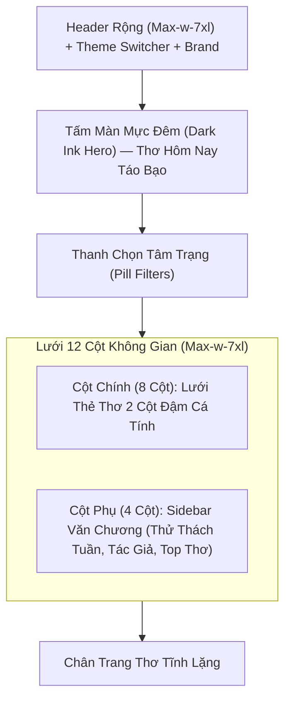

# Thơ Mộc — Design System & Visual Guidelines (DESIGN.md)

Tài liệu này định hình toàn bộ ngôn ngữ thiết kế thị giác, hệ thống màu sắc, kiểu chữ và bố cục không gian cho Thơ Mộc. Mọi thành phần giao diện mới đều phải tuân thủ nghiêm ngặt các quy tắc dưới đây.

---

## 1. Triết Lý & Bản Sắc (Philosophy & Brand Identity)

- **Cảm hứng chủ đạo**: Quán cà phê sách thi vị, trang báo văn chương cổ điển (như *Poetry Foundation*, *The Paris Review*, *The Marginalian*).
- **Không gian cảm xúc**: Tĩnh lặng, mộc mạc, hoài niệm và sâu lắng.
- **Quy tắc Anti-AI Slop**:
  - ❌ Cấm tuyệt đối gradient tím/xanh generic của các template công nghệ.
  - ❌ Cấm bo góc tròn trịa bóng bẩy kiểu Web3 / Crypto dashboard.
  - ❌ Cấm bố cục hẹp bó buộc như mobile phóng to trên màn hình lớn.
  - ✅ Luôn tạo sự tương phản đậm nhạt có chủ đích (ví dụ: Hero vùng tối mực đêm đối lập với trang giấy kem sáng).

---

## 2. Hệ Thống Kiểu Chữ (Typography System)

| Mục đích | Font Family | Trọng lượng | Ứng dụng |
| :--- | :--- | :--- | :--- |
| **Thơ & Tiêu đề chính** | `Lora`, Georgia, serif | 400 (Regular), 700 (Bold) | Thân bài thơ, trích dẫn, tựa đề bài thơ, logo. Hỗ trợ trọn vẹn dấu tiếng Việt. |
| **Giao diện & Siêu dữ liệu** | `Plus Jakarta Sans`, sans-serif | 400, 500, 600 | Thanh điều hướng, nhãn tác giả, ngày tháng, thời gian đọc, nút bấm. |

- **Quy chuẩn hiển thị thơ**:
  - Luôn giữ nguyên vẹn ngắt dòng và khoảng cách khổ thơ (`whitespace-pre-line`).
  - Khổ thơ căn giữa thanh nhã, độ dài dòng lý tưởng $60 - 70$ ký tự.
  - Khoảng cách dòng mở rộng (`leading-loose` / 1.8 - 2.2).
  - Khổ thơ đầu có thể sử dụng chữ cái đầu phóng lớn (Drop Cap).

---

## 3. Bảng Màu & Design Tokens (Color Palette)

### A. 3 Tông Nền Đọc Thơ (Reading Surfaces)
1. **Giấy Trắng Mộc (`light`)**:
   - Nền (`--theme-bg`): `#f8f6f0` (kem sáng tự nhiên)
   - Bề mặt (`--theme-surface`): `#ffffff`
   - Màu chữ (`--theme-text`): `#262320` (mực đen ấm)
   - Đường viền (`--theme-border`): `#e6e0d2`
2. **Giấy Cổ Điển (`sepia`)**:
   - Nền (`--theme-bg`): `#f5eedc` (giấy dó ngả vàng)
   - Bề mặt (`--theme-surface`): `#fbf6e8`
   - Màu chữ (`--theme-text`): `#3d3122` (nâu gỗ trầm)
   - Đường viền (`--theme-border`): `#e3d7be`
3. **Mực Đêm (`dark`)**:
   - Nền (`--theme-bg`): `#141312` (mực than thẫm)
   - Bề mặt (`--theme-surface`): `#1d1b19`
   - Màu chữ (`--theme-text`): `#eae5de` (trắng ngà dịu mắt)
   - Đường viền (`--theme-border`): `#2c2926`

### B. Bảng Màu Cảm Xúc Theo Tâm Trạng (Mood Tokens)
- 🍂 **Mùa thu**: Hổ phách trầm (`amber-100` / `amber-900`)
- 🌧️ **Mưa rơi**: Xanh đá xám (`slate-100` / `slate-800`)
- 🌙 **Nỗi nhớ**: Tím chàm than (`indigo-100` / `indigo-900`)
- ❤️ **Tình yêu**: Hồng đất nhung (`rose-100` / `rose-900`)
- 🍃 **Tĩnh lặng**: Xanh rêu đá (`emerald-100` / `emerald-900`)
- ⏳ **Hoài niệm**: Nâu be trầm (`stone-200` / `stone-900`)

---

## 4. Cấu Trúc Bố Cục Không Gian (Layout Architecture)

- **Màn hình lớn ($\ge 1280\text{px}$)**: Khai thác trọn vẹn bề ngang `max-w-7xl`, phân chia cột $8 / 4$ giữa dòng thơ và sidebar văn học.
- **Trang Chi Tiết Bài Thơ**: Cột đọc thơ giữ ở chuẩn $65\text{ch}$ tối ưu thị giác, đi kèm thanh công cụ đọc nổi (đổi cỡ chữ, đổi màu giấy, chế độ tĩnh lặng, nghe ngâm thơ, xuất thẻ thơ).
- **Trang Đăng Nhập / Đăng Ký**: Bố cục chia đôi (Split-screen) — bên trái là câu thơ kinh điển trên nền mực đen, bên phải là form nhập liệu.

---

## 5. Chất Liệu & Chi Tiết Thủ Công (Artisanal Touches)

1. **Paper Noise Overlay**: Lớp texture hạt nhiễu mịn tự nhiên ($0.035$ opacity) phủ toàn bộ giao diện tạo cảm giác như sờ vào bề mặt giấy in mộc.
2. **Khung Viền Nét Mực**: Viền kép tinh tế trên các thẻ bài và thẻ chia sẻ ảnh.
3. **Thẻ Thơ Chia Sẻ**: Xuất ảnh định dạng chuẩn $1080 \times 1350$ cho mạng xã hội với typography thanh nhã và con dấu mộc.

