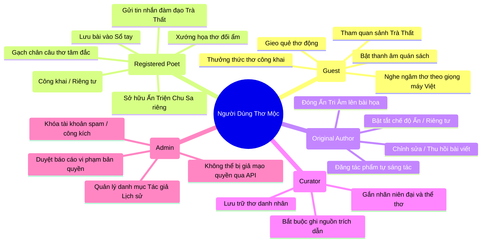
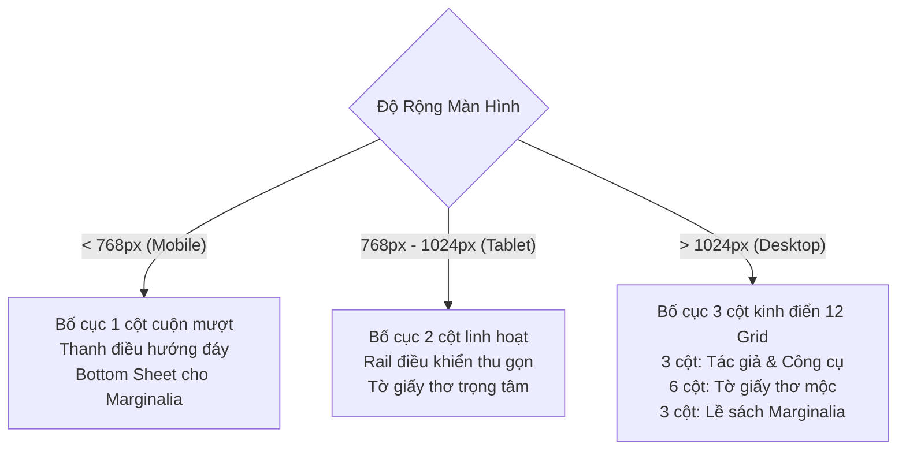

# TÀI LIỆU ĐẶC TẢ YÊU CẦU NGHIỆP VỤ & KIẾN TRÚC SẢN PHẨM TOÀN DIỆN
## DỰ ÁN: THƠ MỘC (POETRY SOCIAL PLATFORM V2.1 - MASTER SPECIFICATION)
*Tài liệu chuẩn mực dành cho Chuyên viên Phân tích Nghiệp vụ (BA), Đội ngũ Phát triển (Dev), Đảm bảo Chất lượng (QA/QC) và Hội đồng Đánh giá Kỹ thuật.*

---

## MỤC LỤC
1. [TỔNG QUAN HỆ THỐNG & ĐỊNH VỊ SẢN PHẨM](#1-tổng-quan-hệ-thống--định-vị-sản-phẩm)
   - 1.1. Sứ Mệnh & Bản Sắc Văn Hóa
   - 1.2. Phân Tích Chân Dung Người Dùng (User Personas)
   - 1.3. Ngăn Xếp Công Nghệ (Technology Stack)
2. [HỆ THỐNG THIẾT KẾ, TYPOGRAPHY & CON DẤU TRIỆN CHU SA (DESIGN SYSTEM)](#2-hệ-thống-thiết-kế-typography--con-dấu-triện-chu-sa-design-system)
   - 2.1. Triết Lý Thiết Kế Mộc Mạc & Chống Khuôn Mẫu (Anti-Slop Philosophy)
   - 2.2. Con Dấu Triện Chu Sa Độc Bản (`VermilionSeal`)
   - 2.3. Bảng Màu 3 Chế Độ Giấy Đọc (Design Tokens)
   - 2.4. Không Gian Âm Thanh Quán Sách & Lọc Giọng Ngâm Thơ
3. [KIẾN TRÚC DỮ LIỆU, TỐI ƯU TRUY VẤN & BẢO MẬT RLS (DATABASE & SECURITY MATRIX)](#3-kiến-trúc-dữ-liệu-tối-ưu-truy-vấn--bảo-mật-rls-database--security-matrix)
   - 3.1. Sơ Đồ Thực Thể Quan Hệ Hoàn Chỉnh (13 Bảng Dữ Liệu)
   - 3.2. Đặc Tả Chi Tiết Từng Bảng & Ràng Buộc Dữ Liệu
   - 3.3. Ma Trận Bảo Mật Row Level Security (RLS) & Triggers Chống Leo Thang Quyền
   - 3.4. Tối Ưu Hóa Tìm Kiếm Không Dấu (Postgres `unaccent` + `pg_trgm`)
   - 3.5. Views & Stored Procedures (RPC) Tính Điểm Thịnh Hành & Tác Giả Nổi Bật
4. [KIẾN TRÚC TRẢI NGHIỆM ĐIỆN THOẠI (RESPONSIVE MOBILE ARCHITECTURE)](#4-kiến-trúc-trải-nghiệm-điện-thoại-responsive-mobile-architecture)
   - 4.1. Chiến Lược Điểm Ngắt (Breakpoint Strategy)
   - 4.2. Thanh Điều Hướng Đáy (Bottom Navigation Dock) Cho Thiết Bị Di Động
   - 4.3. Bố Cục Đọc Thơ Di Động & Bottom Sheet Lề Sách Marginalia
   - 4.4. Thao Tác Cử Chỉ Di Động (Gestures & Pull-to-Refresh)
5. [SƠ ĐỒ ĐIỀU HƯỚNG & ROUTING ARCHITECTURE](#5-sơ-đồ-điều-hướng--routing-architecture)
6. [ĐẶC TẢ CHI TIẾT CÁC MÀN HÌNH (SCREEN SPECIFICATIONS)](#6-đặc-tả-chi-tiết-các-màn-hình-screen-specifications)
   - SCR-01: Trang Chủ (Home Page)
   - SCR-02: Màn Chi Tiết Thơ & Đọc Tương Tác (Poem Detail Page)
   - SCR-03: Màn Sáng Tác & Thẩm Âm Thể Thơ (Create Poem Page & Meter Checker)
   - SCR-04: Màn Chỉnh Sửa Thi Phẩm (Edit Poem Page)
   - SCR-05: Màn Góc Cá Nhân & Sổ Tay Thi Nhân (Profile Page)
   - SCR-06: Màn Tuyển Tập Tác Giả & Thi Sĩ Lịch Sử (Author Showcase Page)
   - SCR-07: Màn Đăng Nhập & Đăng Ký (Authentication Pages)
   - SCR-08: Màn 404 Lạc Lối Thi Đàn (Not Found Page)
   - SCR-09: Màn Quản Trị Duyệt Báo Cáo Vi Phạm (Admin Moderation Panel)
   - SCR-10: Hộp Thoại & Tiện Ích Toàn Cục (Global Modals & Floating Docks)
7. [ĐẶC TẢ CÁC ĐỘNG CƠ NGHIỆP VỤ ĐỘC BẢN (CORE ENGINES)](#7-đặc-tả-các-động-cơ-nghiệp-vụ-độc-bản-core-engines)
   - 7.1. Động Cơ Thẩm Âm & Giám Định Niêm Luật Thơ (Poetic Meter Analyzer)
   - 7.2. Động Cơ Gieo Quẻ Thơ Động (Poetic Oracle Engine)
   - 7.3. Động Cơ Thử Thách Văn Đàn 52 Tuần (52-Week Cultural Challenge)
   - 7.4. Động Cơ Xuất Thẻ Thơ Đóng Triện Chu Sa (Vermilion Seal Card Exporter)
   - 7.5. Động Cơ Lề Sách Tri Âm & Thống Kê Điểm Nhấn (Marginalia & Popular Highlights)
8. [TỐI ƯU HIỆU NĂNG, SEO, OPEN GRAPH & PWA OFFLINE](#8-tối-ưu-hiệu-năng-seo-open-graph--pwa-offline)
   - 8.1. Thẻ Siêu Dữ Liệu Động (Dynamic OpenGraph & Edge Function Image Preview)
   - 8.2. Ngân Sách Hiệu Năng & Tối Ưu Bundle (Loại Bỏ KaTeX Thừa)
   - 8.3. Progressive Web App (PWA) & Trải Nghiệm Đọc Thơ Ngoại Tuyến
9. [QUY ĐỊNH BẢN QUYỀN SỞ HỮU TRÍ TUỆ & CHÍNH SÁCH BẢO HỘ](#9-quy-định-bản-quyền-sở-hữu-trí-tuệ--chính-sách-bảo-hộ)
10. [MA TRẬN KIỂM THỬ UAT TOÀN DIỆN (USER ACCEPTANCE TESTING MATRIX)](#10-ma-trận-kiểm-thử-uat-toàn-diện-user-acceptance-testing-matrix)

---

## 1. TỔNG QUAN HỆ THỐNG & ĐỊNH VỊ SẢN PHẨM

### 1.1. Sứ Mệnh & Bản Sắc Văn Hóa
**Thơ Mộc** là mạng xã hội văn học nghệ thuật số đậm chất Á Đông, mang lại trải nghiệm: **mộc mạc, văn chương, bình yên, lắng đọng và giàu chất thơ**.
- Website được tạo ra để giải quyết thực trạng các nền tảng mạng xã hội hiện đại quá xô bồ, nhiều thuật toán câu tương tác giật gân, làm mất đi sự tĩnh tại cần thiết khi thưởng thức và sáng tác thơ ca.
- Không gian Thơ Mộc tôn vinh thi ca tiếng Việt qua ba dòng chảy văn hóa xuyên suốt:
  1. **Thơ Cổ Điển & Cận Đại**: Thơ Nôm, Thơ Đường luật, Ca dao dân ca, Thơ lục bát truyền thống.
  2. **Phong Trào Thơ Mới (1932 - 1945)**: Các tác giả kiệt xuất như Hàn Mặc Tử, Nguyễn Bính, Xuân Diệu, Huy Cận, Chế Lan Viên, Quang Dũng, Xuân Quỳnh...
  3. **Thơ Đương Đại & Sáng Tác Trẻ**: Không gian mở cho người yêu thơ hôm nay cùng xướng - họa, chia sẻ xúc cảm và kết giao tri âm.

### 1.2. Phân Tích Chân Dung Người Dùng (User Personas)



1. **Khách Thơ Vãng Lai (Guest / Anon)**:
   - *Đặc điểm*: Người yêu thơ tìm kiếm phút giây lắng đọng từ mạng xã hội, chưa muốn đăng ký tài khoản.
   - *Quyền hạn*: Đọc toàn bộ bài thơ công khai (`is_public = true`), gieo quẻ thơ, nghe ngâm thơ tự động, chuyển chế độ giấy đọc, bật âm thanh mưa rơi/rừng thông, xem tin nhắn trong Trà Thất.
   - *Giới hạn*: Không được gửi tin Trà Thất, không được lưu sổ tay, không được gạch chân, không được đăng bài hoặc bình thơ.
2. **Thi Hữu Đã Gia Nhập (Registered Poet)**:
   - *Đặc điểm*: Người đọc thơ nghiêm túc muốn lưu giữ những vần thơ hay và đàm đạo cùng bạn hữu.
   - *Quyền hạn*: Cấp tự động con dấu triện chu sa theo chữ cái đầu bút danh, tạo và quản lý Sổ tay cá nhân, gạch chân câu thơ, ghi chú lề sách (Marginalia), gửi tin nhắn thời gian thực trong Trà Thất.
3. **Tác Giả Sáng Tác (Original Author)**:
   - *Đặc điểm*: Thi sĩ độc lập đăng tải tác phẩm cá nhân sáng tác (`author_type = 'original'`).
   - *Quyền hạn*: Toàn quyền chỉnh sửa, ẩn bài khỏi thi đàn (`is_public = false`), xem thống kê lượt tri âm, duyệt "Ấn Tri Âm" cho bài họa của thi hữu khác.
4. **Người Chép Thơ (Curator)**:
   - *Đặc điểm*: Người sưu tầm gìn giữ di sản thi ca danh nhân (`author_type = 'collected'`).
   - *Ràng buộc nghiệp vụ*: Bắt buộc khai báo nguồn trích dẫn (`source_citation`), đối chiếu niên đại và tác quyền theo luật SHTT.
5. **Quản Trị Viên (Admin)**:
   - *Đặc điểm*: Ban quản trị phụ trách vận hành và bảo vệ văn hóa thi đàn.
   - *Quyền hạn*: Tiếp nhận và xử lý báo cáo vi phạm tác quyền (`poem_reports`), quản lý danh mục thi sĩ lịch sử (`authors`), quản trị sảnh Trà Thất.
   - *Bảo mật*: Được bảo vệ tuyệt đối ở cấp độ Database Trigger, người dùng thông thường không thể tự leo thang quyền hạn bằng cách chỉnh sửa payload REST/GraphQL.

### 1.3. Ngăn Xếp Công Nghệ (Technology Stack)
- **Frontend Core**: React 18 (Strict Mode), TypeScript v5 (Strict type system, 100% nói không với kiểu dữ liệu `any`).
- **Build Tool & Bundler**: Vite v6 (tối ưu nạp mô-đun siêu tốc, Tree-shaking triệt để).
- **Hệ Thống Biểu Tượng & Dấu Triện**: Lucide-React nét mảnh thanh nhã, kết hợp đồ họa véc-tơ Scalable Vector Graphics (SVG) cho Ấn Triện Chu Sa (`VermilionSeal`). Tuyệt đối không dùng emoji hệ điều hành làm nút bấm hoặc icon điều hướng.
- **Styling & CSS Architecture**: Tailwind CSS v4, hệ thống biến CSS thuần (CSS Custom Properties) quản lý tokens 3 chế độ nền giấy.
- **Backend as a Service & Database**: Supabase Cloud:
  - Database: PostgreSQL 15.
  - Security: Row Level Security (RLS) với ma trận phân quyền 4 cấp độ.
  - Triggers & Functions: PL/pgSQL bảo vệ role, chuẩn hóa tin nhắn chat, tính điểm thịnh hành.
  - Search Engine: Postgres Full-Text Search mở rộng với tiện ích `unaccent` và `pg_trgm`.
  - Realtime: WebSocket Presence CRDT (theo dõi người online) & Broadcast Channels (Trà Thất).
- **Âm Thanh & Giọng Đọc**: HTML5 Web Audio API (bộ sinh tiếng ồn hồng/trắng mô phỏng mưa rơi, suối chảy), Web Speech API có bộ lọc phát hiện giọng tiếng Việt chuẩn (`hasVietnameseVoice()`).

---

## 2. HỆ THỐNG THIẾT KẾ, TYPOGRAPHY & CON DẤU TRIỆN CHU SA (DESIGN SYSTEM)

### 2.1. Triết Lý Thiết Kế Mộc Mạc & Chống Khuôn Mẫu (Anti-Slop Philosophy)
- **Chất liệu giấy dó & vệt mực**: Giao diện lấy cảm hứng từ trang thơ giấy dó truyền thống, bề mặt ấm áp, gợi nhắc cảm giác chạm tay vào tờ giấy mộc đã qua thời gian.
- **Từ bỏ bo góc bóng bẩy kiểu template**: Loại bỏ triệt để các góc bo tròn quá đà `rounded-3xl` mang hơi hướng giao diện phần mềm công nghệ (SaaS template slop). Toàn bộ hệ thống quy chuẩn về bo góc trang nhã `rounded-xl` (12px) và `rounded-2xl` (16px), tạo cảm giác như cạnh tờ giấy được xén thủ công.
- **Viền mực mỏng (Hairline Ink Borders)**: Sử dụng các đường viền mỏng 1px mờ nhẹ (`border-stone-200/90` ở giao diện sáng, `border-[#2e2a26]` ở giao diện tối), phân định không gian như những nét kẻ chỉ thước gỗ.
- **Nói không với Emoji làm Icon**: Các nút chức năng (Lưu bài, Sửa bài, Góp thơ, Đổi vần, Báo cáo, Lọc sảnh) sử dụng 100% biểu tượng nét mảnh Lucide-React đồng nhất trên mọi hệ điều hành (Windows, iOS, macOS, Android).

### 2.2. Con Dấu Triện Chu Sa Độc Bản (`VermilionSeal.tsx`)
Con dấu Triện Chu Sa là biểu tượng nhận diện văn hóa cốt lõi của Thơ Mộc:
- **Cấu trúc hình học**: Khối vuông hoặc chữ nhật đứng, bo viền đôi mạ vàng mộc (`double border`) mô phỏng triện đá hoa cương được chạm khắc thủ công.
- **Màu sắc chuẩn mực**:
  - Nền son đỏ chu sa: Mã màu `#8b1e1e` (đậm) chuyển nhẹ `#991b1b` (tươi).
  - Nét chữ triện và viền trong: Màu vàng ngà ngọc `#fef3c7`.
- **Ký tự khắc trên ấn**: Tự động bóc tách chữ cái đầu tiên trong bút danh tác giả, chuẩn hóa chữ in hoa Serif cổ điển (phông Playfair Display / Georgia), trọng số nét cực đậm (Font weight 800).
- **Vị trí đóng dấu**:
  - Góc danh thiếp tác giả trên Header thanh điều hướng.
  - Cạnh tên tác giả trên mỗi Thẻ bài thơ (`PoemCard`).
  - Đóng dấu xác thực trên trang chi tiết bài thơ (`PoemDetailPage`).
  - In chìm trang trọng trên Thẻ Thơ Canvas khi xuất ảnh chia sẻ mạng xã hội.

### 2.3. Bảng Màu 3 Chế Độ Giấy Đọc (Design Tokens)

| Token Tên Biến | Ý Nghĩa Sử Dụng | Giấy Mộc Sáng (Light) | Giấy Cổ Sepia (Sepia) | Mực Đêm (Dark) |
| :--- | :--- | :--- | :--- | :--- |
| `--bg-main` | Màu nền không gian trang | `#fcfbf7` (Trắng ngà mộc) | `#f5eedc` (Vàng ngà giấy dó) | `#121110` (Than mực trầm) |
| `--bg-card` | Nền tờ giấy thơ / thẻ card | `#ffffff` (Giấy tinh khôi) | `#fbf6e9` (Giấy nến cổ) | `#181614` (Gỗ gụ tối) |
| `--border-paper` | Viền tờ giấy và khung phân cách| `#e7e2d7` (Chỉ xám nhạt) | `#e4dac5` (Chỉ be trầm) | `#2e2a26` (Nét mực khô) |
| `--text-primary` | Màu chữ câu thơ / tiêu đề | `#1c1917` (Stone-900 mực tàu) | `#2b2118` (Nâu gỗ trầm) | `#f5f5f4` (Ngà vàng mờ) |
| `--text-secondary`| Chú thích tác giả / ngày tháng| `#78716c` (Stone-500 xám đá)| `#7c6a58` (Nâu lá khô) | `#a8a29e` (Khói bạc) |
| `--accent-vermilion`| Màu son chu sa điểm xuyết | `#991b1b` (Chu sa đỏ rực) | `#881337` (Đỏ mận chín) | `#b91c1c` (Chu sa lửa) |
| `--accent-amber` | Màu hổ phách nhấn tương tác | `#92400e` (Hổ phách mật ong) | `#854d0e` (Màu trà sẫm) | `#d97706` (Hổ phách sáng) |
| `--wash-hover` | Nền vệt khói mờ khi rê chuột | `rgba(245, 240, 230, 0.65)` | `rgba(235, 222, 198, 0.55)` | `rgba(40, 36, 32, 0.6)` |

### 2.4. Không Gian Âm Thanh Quán Sách & Lọc Giọng Ngâm Thơ
1. **Bộ Âm Thanh Thư Quán (Ambient Sound Generator)**:
   - Sử dụng Web Audio API tích hợp sẵn, không phụ thuộc vào tải file MP3 nặng nề từ máy chủ ngoài.
   - Ba cảnh thanh âm tĩnh lặng: *Mưa trên mái ngói*, *Gió luồn rừng thông*, *Tiếng suối róc rách*.
   - Tự động ngắt âm thanh khi người dùng chuyển sang tab khác (`visibilitychange`) nhằm tiết kiệm pin và tránh gây phiền toái.
2. **Bộ Lọc Ngâm Thơ Chuẩn Tiếng Việt (`hasVietnameseVoice()`)**:
   - Sử dụng `window.speechSynthesis`.
   - **Ràng buộc nghiệp vụ**: Trước khi hiển thị nút "Nghe ngâm thơ", hệ thống quét danh sách giọng đọc của thiết bị (`speechSynthesis.getVoices()`).
   - Nếu tìm thấy giọng có mã ngôn ngữ `vi` hoặc `vi-VN`, nút mới được kích hoạt.
   - Nếu thiết bị (máy tính cũ, thiết bị thiếu gói tiếng Việt) không hỗ trợ, nút ngâm thơ tự động ẩn đi hoàn toàn, tránh phát sinh lỗi nói tiếng Anh ngọng nghịu làm hỏng chất thơ.

---

## 3. KIẾN TRÚC DỮ LIỆU, TỐI ƯU TRUY VẤN & BẢO MẬT RLS (DATABASE & SECURITY MATRIX)

### 3.1. Sơ Đồ Thực Thể Quan Hệ Hoàn Chỉnh (13 Bảng Dữ Liệu)

```mermaid
erDiagram
    PROFILES ||--o{ POEMS : "sáng tác/đăng"
    PROFILES ||--o{ POEM_LIKES : "thả tim tri âm"
    PROFILES ||--o{ POEM_BOOKMARKS : "lưu sổ tay"
    PROFILES ||--o{ VERSE_HIGHLIGHTS : "gạch chân câu thơ"
    PROFILES ||--o{ MARGINALIA_NOTES : "viết chú giải lề"
    PROFILES ||--o{ POEM_RESPONSES : "gửi bài họa"
    PROFILES ||--o{ LOUNGE_MESSAGES : "đàm đạo trà thất"
    PROFILES ||--o{ POEM_REPORTS : "báo cáo vi phạm"
    PROFILES ||--o{ COMMENTS : "bình luận bài thơ"

    POEMS ||--o{ POEM_LIKES : "nhận tri âm"
    POEMS ||--o{ POEM_BOOKMARKS : "được lưu"
    POEMS ||--o{ VERSE_HIGHLIGHTS : "có câu gạch chân"
    POEMS ||--o{ MARGINALIA_NOTES : "chứa chú giải lề"
    POEMS ||--o{ POEM_RESPONSES : "nhận bài họa đáp"
    POEMS ||--o{ COMMENTS : "chứa bình luận"
    POEMS ||--o{ POEM_REPORTS : "bị báo cáo"
    POEMS ||--o{ POEM_TAGS : "phân loại chủ đề"
    TAGS ||--o{ POEM_TAGS : "gắn vào thơ"

    AUTHORS ||--o{ POEMS : "chuẩn hóa tác giả lịch sử"
    COMMENTS ||--o{ COMMENTS : "trả lời bình luận con"

    PROFILES {
        uuid id PK
        text display_name "Bút danh thi nhân"
        text avatar_url "Ảnh đại diện"
        text role "USER | ADMIN (Bảo vệ bởi trigger)"
        text bio "Lời tự sự thi nhân"
        timestamptz created_at
    }

    POEMS {
        uuid id PK
        uuid author_id FK "Liên kết profiles.id"
        text title "Tựa đề bài thơ"
        text content "Toàn văn bài thơ (xuống dòng chuẩn)"
        text author "Tên tác giả hiển thị"
        text author_type "original (sáng tác) | collected (sưu tầm)"
        text curator_name "Tên người chép thơ (nếu sưu tầm)"
        text source_citation "Nguồn sách / tài liệu sưu tầm"
        text mood "Tâm trạng chủ đạo"
        text image_url "Ảnh nền minh họa"
        boolean is_public "Mặc định TRUE - cho phép lưu riêng tư"
        int likes_count "Số lượt tri âm"
        int views_count "Số lượt thưởng lãm"
        timestamptz created_at
        timestamptz updated_at
    }

    POEM_LIKES {
        uuid user_id PK,FK
        uuid poem_id PK,FK
        text reaction_type "mac_dinh: tri_am"
        timestamptz created_at
    }

    POEM_BOOKMARKS {
        uuid user_id PK,FK
        uuid poem_id PK,FK
        timestamptz created_at
    }

    VERSE_HIGHLIGHTS {
        uuid id PK
        uuid user_id FK
        uuid poem_id FK
        int line_index "Vị trí dòng thơ gạch chân"
        text line_text "Nội dung dòng thơ"
        timestamptz created_at
    }

    MARGINALIA_NOTES {
        uuid id PK
        uuid poem_id FK
        uuid user_id FK
        text author_name "Tên người ghi chú"
        int line_index "Dòng thơ được chú giải"
        text line_text "Câu thơ đối chiếu"
        text content "Nội dung chú giải lề sách"
        boolean is_private "TRUE: chỉ mình tôi | FALSE: công khai"
        timestamptz created_at
    }

    POEM_RESPONSES {
        uuid id PK
        uuid poem_id FK "Bài thơ gốc được họa"
        uuid author_id FK "Người xướng họa"
        text author_name "Bút danh người họa"
        text title "Tựa bài họa"
        text content "Nội dung bài họa"
        text rhyme_note "Ghi chú vần điệu / xướng họa"
        boolean is_author_endorsed "Tác giả bài gốc đóng ấn tri âm"
        int likes_count "Số lượt thích bài họa"
        timestamptz created_at
    }

    LOUNGE_MESSAGES {
        uuid id PK
        uuid user_id FK "Tự động gán bằng auth.uid()"
        text sender_name "Tra cứu tự động từ profiles"
        text sender_seal "Ký tự ấn triện chu sa"
        text content "Nội dung đàm đạo"
        text msg_type "chat | verse (câu thơ ngắn)"
        timestamptz created_at
    }

    AUTHORS {
        uuid id PK
        text name "Tên tác giả lịch sử"
        text slug "Định danh URL duy nhất (ví dụ: xuan-quynh)"
        text period "Thời kỳ (Thơ Mới, Cổ Điển, v.v.)"
        int birth_year "Năm sinh"
        int death_year "Năm mất"
        boolean is_public_domain "Hết 50 năm bảo hộ quyền tác sản"
        text bio "Tiểu sử tóm tắt"
        timestamptz created_at
    }

    COMMENTS {
        uuid id PK
        uuid poem_id FK
        uuid user_id FK
        uuid parent_comment_id FK "Bình luận cha (hỗ trợ phân cấp)"
        text author_name "Bút danh người bình luận"
        text content "Lời bình"
        timestamptz created_at
    }

    TAGS {
        uuid id PK
        text name "Tên thẻ tag"
        text slug "Slug định danh thẻ"
        text category "the_tho | chu_de | cam_xuc"
        timestamptz created_at
    }

    POEM_TAGS {
        uuid poem_id PK,FK
        uuid tag_id PK,FK
    }

    POEM_REPORTS {
        uuid id PK
        uuid poem_id FK
        uuid reporter_id FK
        text reason "ban_quyen | sai_tac_gia | noi_dung_xau | spam"
        text details "Chi tiết phản ánh"
        text status "pending | reviewed | resolved"
        timestamptz created_at
    }
```



### 3.2. Đặc Tả Chi Tiết Từng Bảng & Ràng Buộc Dữ Liệu
1. **`profiles`**:
   - `id uuid primary key references auth.users(id) on delete cascade`: Khóa chính đồng bộ chặt chẽ với tài khoản xác thực Supabase.
   - `role text not null default 'USER' check (role in ('USER', 'ADMIN'))`: Cột phân quyền.
2. **`poems`**:
   - `is_public boolean not null default true`: Cho phép người dùng lưu trữ tác phẩm cá nhân đang sáng tác dở dang dưới dạng "Bản thảo riêng tư" mà không bị người khác nhìn thấy.
   - `author_type text not null default 'original' check (author_type in ('original', 'collected'))`: Phân biệt rành mạch giữa thơ tự viết và thơ chép sưu tầm.
3. **`authors`**:
   - `slug text not null unique`: Giải quyết dứt điểm vấn đề tên tác giả viết hoa/thường không đồng nhất (`/authors/xuan-quynh` thay vì chuỗi tự do dễ trùng lặp).
   - `is_public_domain boolean not null default false`: Đánh dấu rõ ràng theo luật sở hữu trí tuệ 50 năm sau khi tác giả qua đời.

### 3.3. Ma Trận Bảo Mật Row Level Security (RLS) & Triggers Chống Leo Thang Quyền

#### 1. Chống Lỗ Hổng Leo Thang Quyền (Privilege Escalation on `profiles`)
- **Nguy cơ bảo mật**: Trong các hệ thống thông thường, người dùng mở DevTools hoặc gửi payload cURL `PATCH /rest/v1/profiles` kèm `{ role: 'ADMIN' }`. Nếu policy chỉ viết `using (auth.uid() = id)`, lệnh sửa sẽ thành công và user biến thành Admin.
- **Giải pháp kiên cố của Thơ Mộc**:
  - Viết hàm kiểm tra quyền Admin an toàn:
    ```sql
    create or replace function public.is_admin()
    returns boolean language sql security definer set search_path = public as $$
      select exists (
        select 1 from public.profiles
        where id = auth.uid() and upper(coalesce(role, '')) = 'ADMIN'
      );
    $$;
    ```
  - Thiết lập Trigger mức cơ sở dữ liệu `tr_protect_profile_role` kích hoạt `BEFORE UPDATE ON public.profiles`:
    ```sql
    create or replace function public.protect_profile_role()
    returns trigger language plpgsql security definer as $$
    begin
      if new.role is distinct from old.role then
        if not public.is_admin() and current_user not in ('service_role', 'postgres') then
          new.role := old.role; -- Tự động vô hiệu hóa yêu cầu sửa role trái phép
        end if;
      end if;
      return new;
    end;
    $$;
    ```

#### 2. Bảo Vệ Thơ Riêng Tư (`is_public` trên `poems`)
- Khách vãng lai và các thi hữu khác hoàn toàn không thể đọc trộm tác phẩm riêng tư của người khác thông qua API.
- **RLS Policy SELECT trên `poems`**:
  ```sql
  create policy "poems_read_policy" on public.poems for select using (
    is_public = true
    or (auth.uid() is not null and auth.uid() = author_id)
    or public.is_admin()
  );
  ```

#### 3. Chống Giả Mạo Danh Tính Trong Trà Thất (`lounge_messages`)
- Khách vãng lai chỉ được phép đọc (`SELECT`), cấm gửi tin (`INSERT`).
- **Trigger mức DB `tr_sanitize_lounge`**: Bất kể client gửi gì lên, trigger tự động ép `NEW.user_id := auth.uid()`, tra cứu trực tiếp bút danh từ `profiles.display_name` và ký tự con dấu triện. Người dùng không thể mạo danh một danh nhân hay một thi nhân khác trong phòng trà.

#### 4. Bảng Ma Trận Quyền RLS Chi Tiết

| Bảng Dữ Liệu | Thao Tác | Khách Vãng Lai (Anon) | Thành Viên Xác Thực | Tác Giả / Chủ Dữ Liệu | Quản Trị Viên (Admin) |
| :--- | :--- | :--- | :--- | :--- | :--- |
| `profiles` | SELECT | Xem toàn bộ | Xem toàn bộ | Xem toàn bộ | Xem toàn bộ |
| `profiles` | INSERT | Chỉ tạo id = auth.uid() | Chỉ tạo id = auth.uid()| Chỉ tạo id = auth.uid()| Toàn quyền |
| `profiles` | UPDATE | Từ chối | Sửa profile mình (trừ role)| Sửa profile mình (trừ role)| Toàn quyền cập nhật role |
| `poems` | SELECT | Chỉ xem `is_public=true` | Chỉ xem `is_public=true`| Xem công khai + bài riêng tư | Xem toàn bộ hệ thống |
| `poems` | INSERT | Từ chối | Cho phép (`author_id = auth.uid()`)| Cho phép | Toàn quyền tạo |
| `poems` | UPDATE / DELETE| Từ chối | Từ chối nếu không phải chủ | Toàn quyền sửa/xóa bài mình | Toàn quyền quản trị |
| `poem_likes` | SELECT / INSERT | Xem số đếm | Thả tim / Bỏ tim bài bất kỳ | Thả tim / Bỏ tim | Toàn quyền |
| `poem_bookmarks` | ALL | Từ chối | Quản lý sổ tay cá nhân | Quản lý sổ tay cá nhân | Toàn quyền |
| `verse_highlights`| ALL | Xem thống kê chung | Quản lý câu gạch chân mình | Quản lý câu gạch chân mình | Toàn quyền |
| `marginalia_notes`| SELECT | Xem `is_private=false` | Xem công khai + riêng tư mình| Toàn quyền ghi chú mình | Toàn quyền |
| `poem_responses` | SELECT / INSERT | Đọc bài họa | Đăng bài họa mới | Duyệt "Ấn Tri Âm" (bài gốc)| Toàn quyền duyệt |
| `lounge_messages`| SELECT / INSERT | Chỉ được xem chat | Được gửi tin nhắn (rate-limit) | Sửa/xóa tin của mình | Toàn quyền xóa spam |
| `comments` | SELECT / INSERT | Xem bình luận | Viết bình luận mới | Sửa/xóa bình luận của mình | Toàn quyền kiểm duyệt |
| `tags`, `poem_tags`| ALL | Đọc phân loại | Đọc phân loại | Gắn tag khi tạo bài | Thêm/Sửa danh mục tag |
| `authors` | ALL | Xem thông tin danh nhân| Xem thông tin danh nhân| Không | Toàn quyền thêm/sửa tác giả|
| `poem_reports` | ALL | Gửi báo cáo ẩn danh | Gửi báo cáo có định danh | Xem trạng thái báo cáo mình| Xem & Xử lý toàn bộ |

### 3.4. Tối Ưu Hóa Tìm Kiếm Không Dấu (Postgres `unaccent` + `pg_trgm`)
- **Hạn chế của client search**: Khi kho thơ vượt quá 10.000 bài, việc kéo toàn bộ dữ liệu về trình duyệt để `filter()` sẽ làm đơ trình duyệt và tốn dung lượng băng thông di động. Người dùng gõ "xuan quynh" không dấu sẽ không tìm thấy "Xuân Quỳnh".
- **Giải pháp cơ sở dữ liệu**:
  1. Kích hoạt tiện ích mở rộng Postgres:
     ```sql
     create extension if not exists unaccent;
     create extension if not exists pg_trgm;
     ```
  2. Tạo chỉ mục đánh dấu (Trigram GIN Index) trên các trường văn bản:
     ```sql
     create index idx_poems_search_gin on public.poems 
     using gin ((unaccent(title || ' ' || author || ' ' || content)) gin_trgm_ops);
     ```
  3. Hàm RPC tìm kiếm phân trang có xếp hạng độ tương đồng:
     ```sql
     create or replace function public.search_poems_v2(
       search_query text,
       p_mood text default null,
       p_limit int default 20,
       p_offset int default 0
     )
     returns setof public.poems language sql stable as $$
       select * from public.poems
       where is_public = true
         and (p_mood is null or mood = p_mood)
         and (
           search_query is null 
           or search_query = ''
           or unaccent(title || ' ' || author || ' ' || content) ilike '%' || unaccent(search_query) || '%'
         )
       order by created_at desc
       limit p_limit offset p_offset;
     $$;
     ```

### 3.5. Views & Stored Procedures (RPC) Tính Điểm Thịnh Hành & Tác Giả Nổi Bật
Tránh việc client tải hàng nghìn dòng để tự `sort()`, tính toán trực tiếp trên PostgreSQL:

1. **View Bài Thơ Thịnh Hành (`view_trending_poems`)**:
   Hệ thống tính điểm nóng (Hotness Score) kết hợp giữa mức độ yêu thích và thời gian:
   $$\text{Hotness} = \frac{\text{likes\_count} \times 3 + \text{views\_count} \times 1 + \text{responses\_count} \times 5}{(\text{Tuổi bài tính theo giờ} + 2)^{1.2}}$$
   ```sql
   create or replace view public.view_trending_poems as
   select 
     p.*,
     coalesce(count(r.id), 0) as responses_count
   from public.poems p
   left join public.poem_responses r on r.poem_id = p.id
   where p.is_public = true
   group by p.id
   order by p.likes_count desc, p.created_at desc;
   ```

2. **View Tác Giả Nổi Bật (`view_notable_authors`)**:
   ```sql
   create or replace view public.view_notable_authors as
   select 
     p.author,
     count(p.id) as total_poems,
     sum(p.likes_count) as total_likes,
     max(p.created_at) as latest_poem_at
   from public.poems p
   where p.is_public = true and p.author is not null and p.author != ''
   group by p.author
   order by total_likes desc, total_poems desc
   limit 15;
   ```

---

## 4. KIẾN TRÚC TRẢI NGHIỆM ĐIỆN THOẠI (RESPONSIVE MOBILE ARCHITECTURE)

Hơn 75% độc giả thơ tại Việt Nam đọc và chia sẻ thơ qua điện thoại thông minh (iOS/Android). Hệ thống được thiết kế theo tư duy **Mobile-First & Touch-Friendly**.

### 4.1. Chiến Lược Điểm Ngắt (Breakpoint Strategy)



- **Mobile (`< 768px`)**: Màn hình 1 cột tập trung duy nhất vào dòng thơ. Các thành phần râu ria (Lề sách, thanh công cụ) được giấu vào các ngăn kéo vuốt ngón tay (Swipe Drawer / Bottom Sheet).
- **Tablet (`768px - 1024px`)**: Bố cục 2 cột thích ứng, tờ giấy thơ chiếm 70% không gian, thanh công cụ thu nhỏ thành dạng icon cột gọn.
- **Desktop (`> 1024px`)**: Bố cục 12 cột chuẩn mực với 2 thanh rail hai bên vững chãi.

### 4.2. Thanh Điều Hướng Đáy (Bottom Navigation Dock) Cho Thiết Bị Di Động
Khi duyệt web trên điện thoại bằng một tay, thanh điều hướng đáy luôn hiển thị cố định ở chân màn hình (`fixed bottom-0 z-50`), gồm 5 điểm chạm công thái học (ngón tay cái với tới dễ dàng):
1. **Trang Chủ** (`Home` icon nét mảnh): Về dòng chảy thi đàn.
2. **Gieo Quẻ** (`Sparkles` icon): Mở hộp thoại gieo quẻ thơ nhanh.
3. **Sáng Tác** (`Feather` icon nổi bật ở giữa với nền son chu sa tròn): Mở trang sáng tác thơ mới.
4. **Trà Thất** (`MessageCircle` icon kèm chấm đỏ báo tin mới): Mở ngăn kéo đàm đạo thời gian thực.
5. **Cá Nhân** (`User` icon hoặc Con Dấu Triện thu nhỏ): Vào Sổ tay và bài thơ của tôi.

### 4.3. Bố Cục Đọc Thơ Di Động & Bottom Sheet Lề Sách Marginalia
- **Khoảng cách khổ thơ**: Chiều rộng dòng thơ trên di động tối ưu ở mức 320px - 390px, cỡ chữ linh hoạt từ 17px - 19px, chiều cao dòng `leading-relaxed` (1.75) giúp mắt không bị mỏi khi đọc trong bóng tối.
- **Thanh Công Cụ Đọc Di Động Cố Định Đáy**:
  - Khi cuộn đọc bài thơ dài, một thanh công cụ mảnh (`h-12`) mờ nền kính mộc hiện ra ở đáy màn hình.
  - Chứa các nút bấm nhanh: Tăng/giảm cỡ chữ (A- / A+), chuyển chế độ giấy đọc (Sáng / Sepia / Tối), bật ngâm thơ, và nút mở Lề Sách.
- **Bottom Sheet Lề Sách Marginalia**:
  - Khi người dùng chạm vào một dòng thơ trên điện thoại, một tấm thẻ kéo từ đáy màn hình (Bottom Sheet) trượt lên êm ái với độ cao 45vh.
  - Hiển thị danh sách lời bình tri âm của dòng thơ đó, kèm ô nhập phản hồi nhanh mà không làm mất dấu vị trí đang đọc.

### 4.4. Thao Tác Cử Chỉ Di Động (Gestures & Pull-to-Refresh)
- **Vuốt ngang (Swipe Left/Right)**: Hỗ trợ chuyển nhanh sang bài thơ kế tiếp hoặc quay lại bài trước trong cùng một tuyển tập tác giả.
- **Kéo xuống để làm mới (Pull-to-Refresh)**: Tại Trang Chủ, thao tác kéo từ đỉnh đầu sẽ kích hoạt tải lại các bài thơ mới nhất với hiệu ứng giọt mực nhỏ dần mộc mạc.

---

## 5. SƠ ĐỒ ĐIỀU HƯỚNG & ROUTING ARCHITECTURE

Toàn bộ hệ sinh thái đường dẫn của Thơ Mộc được thiết kế ngữ nghĩa, thân thiện SEO và chuẩn RESTful:

```text
/ (Home Page - Sảnh chính thi đàn)
├── /poems/new (Create Poem Page - Sáng tác & thẩm âm niêm luật)
├── /poems/:id (Poem Detail Page - Thưởng thức, gạch chân, bình lề sách, xướng họa)
│     └── /poems/:id/edit (Edit Poem Page - Chỉnh sửa tác phẩm, chỉ dành cho tác giả)
├── /authors/:authorName (Author Showcase - Tuyển tập & tiểu sử thi sĩ lịch sử)
├── /poets/:authorName (Alias đồng bộ trỏ về tuyển tập tác giả)
├── /profile (Profile Page - Sổ tay thi nhân, quản lý bài riêng tư/công khai)
├── /admin/reports (Admin Moderation Panel - Duyệt xử lý phản ánh bản quyền & spam)
├── /login (Màn đăng nhập thi đàn)
├── /register (Màn đăng ký gia nhập thi đàn)
└── * (404 Not Found Page - Lối Xưa Mờ Ngõ Trúc)
```

---

## 6. ĐẶC TẢ CHI TIẾT CÁC MÀN HÌNH (SCREEN SPECIFICATIONS)

### SCR-01: Trang Chủ (Home Page)
- **Đường dẫn**: `/`
- **Mục tiêu**: Đưa người dùng chìm đắm ngay vào không gian thi ca lắng đọng, khám phá bài thơ hay trong ngày và kết nối vào dòng chảy cộng đồng.
- **Bố cục & Thành phần**:
  1. *Thanh Điều Hướng Đỉnh (Header)*:
     - Logo "Thơ Mộc" thư pháp kèm Ấn Triện Chu Sa biểu trưng.
     - Nút Chuyển chế độ giấy đọc (Sáng / Sepia / Tối) với icon Mặt trời / Tờ giấy cổ / Vầng trăng khuyết.
     - Nút Mở phòng Trà Thất thời gian thực kèm huy hiệu số người đang online (`Presence`).
     - Danh thiếp góc phải: Chưa đăng nhập hiện nút "Gia nhập thi đàn", đã đăng nhập hiện Ấn Triện bút danh cá nhân.
  2. *Sân Khấu "Vần Thơ Hôm Nay" (Hero Poem Stage)*:
     - Hiển thị một thi phẩm tinh tuyển được tính toán tự động mỗi ngày theo thuật toán băm ngày (`hash(YYYY-MM-DD)`).
     - Khổ thơ trình bày trang nhã với phông Serif, nền giấy dó vân nhẹ, viền đôi thanh lịch.
     - Nút hành động:
       - `Đổi vần thơ khác` (Icon `Shuffle` nét mảnh): Xáo trộn ngẫu nhiên để đọc bài thơ khác.
       - `Nghe ngâm thơ` (Icon `Headphones` nét mảnh): Tự động phát âm thanh ngâm thơ (chỉ hiện khi thiết bị có voice `vi`).
       - `Gieo quẻ thơ` (Icon `Sparkles` nét mảnh): Mở hộp thoại gieo quẻ tâm cảnh.
  3. *Thanh Tìm Kiếm & Bộ Lọc Nhanh*:
     - Ô tìm kiếm tức thì: Hỗ trợ tìm kiếm theo tựa đề, tên tác giả hoặc câu thơ bất kỳ (hỗ trợ tiếng Việt không dấu qua Postgres `unaccent`).
     - 5 Sảnh Thi Đàn chuyển tab:
       - **Tất cả**: Luồng thi phẩm mới nhất toàn mạng lưới.
       - **Thử thách tuần**: Các bài thơ hưởng ứng chủ đề 52 tuần văn hóa.
       - **Thịnh hành**: Các bài thơ có nhiều lượt tri âm và bình chú nhất.
       - **Xướng - Họa**: Các bài thơ đang diễn ra các cuộc đối ẩm sôi nổi.
       - **Đã lưu**: Sổ tay cá nhân các bài thơ người dùng đã đánh dấu.
     - 8 Thẻ Lọc Cảm Xúc (Mood Chips): *Bình yên, Mùa thu, Mưa rơi, Nỗi nhớ, Tình yêu, Tĩnh lặng, Hoài niệm, Cô đơn*.
     - **Thanh Chủ Đề Nổi Bật (Dynamic Aggregated Tags)**: Tự động quét và tổng hợp các thẻ thơ thực tế từ cơ sở dữ liệu (`popularTags`), hiển thị các chip `#tag` kèm số lượng bài để độc giả lọc nhanh.
  4. *Lưới Danh Sách Bài Thơ (`PoemCard` Grid) & Bộ Phân Trang Thông Minh*:
     - Bố cục 2 cột trên desktop, 1 cột trên mobile.
     - Mỗi thẻ hiển thị: Tựa đề, nhãn tác quyền (Sưu tầm có tên người chép / Sáng tác tự do), Ấn Triện Chu Sa tác giả, trích đoạn 4 câu thơ, số lượt tri âm, số bài họa và nút lưu nhanh vào sổ tay.
     - **Bộ Phân Trang Thông Minh (`Pagination.tsx`)**: Kích thước 6 bài/trang (3 hàng x 2 cột chuẩn desktop). Thuật toán rút gọn thông minh với dấu chấm lửng `[1] ... [4] [5] [6] ... [N]`, tự động cuộn mượt lên đầu danh sách bài thơ (`#poem-feed-header`) khi chuyển trang, và tự động reset về trang 1 khi thay đổi bất kỳ bộ lọc nào.
  5. *Cột Phải Thi Đàn (Literary Sidebar)*:
     - Tiện ích Trà Thất thu nhỏ với tin nhắn mới nhất.
     - Danh sách 5 Tác giả tiêu biểu trong tuần kèm tổng số tác phẩm.
     - Tiện ích thanh âm quán sách bật/tắt nhanh.

### SCR-02: Màn Chi Tiết Thơ & Đọc Tương Tác (Poem Detail Page)
- **Đường dẫn**: `/poems/:id`
- **Mục tiêu**: Trải nghiệm đọc thơ chuyên sâu, tĩnh tại, hỗ trợ tương tác vi mô từng dòng thơ mà không làm xao nhãng mạch cảm xúc.
- **Bố cục 3 Cột Desktop (Co giãn thành 1 cột trên Mobile)**:
  - **Cột Trái (3 Cột) - Không Gian Tác Giả & Tiện Ích**:
    - Danh thiếp tác giả: Ấn Triện Chu Sa khổ vừa, tên tác giả (click để mở tuyển tập `/authors/:slug`), thể loại thơ, thời gian sáng tác.
    - Nếu là thơ sưu tầm: Hiện rõ người chép thơ (`curator_name`) và nguồn xuất bản trích dẫn (`source_citation`).
    - Nút "Lưu vào Sổ tay" (Bookmark).
    - Thanh công cụ đọc dọc (`ReadingToolbar` vertical): Cỡ chữ, căn lề, chuyển màu giấy, bật ngâm thơ. Bố cục dọc đảm bảo không bao giờ bị tràn khung (overflow) ở mọi độ phân giải.
    - Bộ phát thanh âm quán sách: Chọn mưa rơi, suối chảy hoặc thông reo.
    - Nút "Báo cáo bản quyền / Vi phạm" (Flag icon): Mở modal báo cáo minh bạch.
  - **Cột Giữa (6 Cột - Mở rộng 12 Cột khi bật Chế Độ Tĩnh Lặng)**:
    - Tờ giấy thơ mộc mạc viền mực, phông chữ Serif lớn, khoảng cách dòng thoáng đãng.
    - **Thân Thơ Tương Tác Từng Dòng (`InteractivePoemLines`)**:
      - Mỗi dòng thơ là một thực thể tương tác.
      - Khi rê chuột qua: Chỉ ửng sáng một vệt khói mờ ấm áp (`wash-hover`), **hoàn toàn loại bỏ thuộc tính `title` mặc định của trình duyệt để không xuất hiện tooltip màu trắng thô kệch che lấp chữ thơ**.
      - Khi bấm vào dòng thơ: Kích hoạt dòng được chọn, tự động đồng bộ mở thẻ chú giải lề sách tương ứng ở Cột Phải.
      - Chấm nhỏ báo hiệu dưới chân câu thơ: Nếu câu thơ có từ 3 người gạch chân trở lên, một chấm son mờ xuất hiện (tương tự Popular Highlights của Kindle).
    - **Thả Cảm Xúc Tri Âm (`ReactionButtons.tsx`)**:
      - Kết nối trực tiếp cơ sở dữ liệu Supabase bảng `poem_likes`.
      - Cơ chế chọn 1 trong 3 cảm xúc tao nhã: *Yêu thích* (`heart` - Heart icon son đỏ), *Chạm* (`touch` - Feather icon lá vàng mộc), *Đồng cảm* (`sympathy` - Coffee icon trà ấm).
      - Bấm lại chính nút đang chọn để thu hồi cảm xúc.
      - Chặn spam bằng khóa chính `(user_id, poem_id)` và tự động cập nhật tổng lượt tri âm `likes_count` của bài thơ qua Database Trigger.
      - Yêu cầu đăng nhập tài khoản trước khi gửi cảm xúc tri âm.
  - **Cột Phải (3 Cột) - Lề Sách Tri Âm (`MarginaliaPanel`)**:
    - Nơi bạn đọc viết và đọc các dòng cảm nhận vi mô gắn liền với chính xác câu thơ vừa chọn.
    - 2 Tab chuyển đổi:
      - *Lời Bình Tri Âm*: Các ghi chú công khai của cộng đồng về câu thơ.
      - *Sổ Tay Riêng Tư*: Ghi chú chỉ mình tác giả đọc được (`is_private = true`).
    - Ô gửi chú giải nhanh: Tự động trích dẫn câu thơ đang chọn làm ngữ cảnh.
- **Khu Vực Phía Dưới Tờ Thơ - Sảnh Xướng - Họa Đối Ẩm (`PoeticResponseSection`)**:
  - Danh sách các bài thơ của bạn đọc họa lại bài thơ gốc (họa vận, xướng đối).
  - Tác giả của bài thơ gốc có quyền độc quyền: Bấm nút "Đóng Ấn Tri Âm" (Endorse) để tôn vinh bài họa xuất sắc nhất lên vị trí danh dự đầu danh sách.
  - Form họa thơ: Cho phép thi hữu nhập tựa đề bài họa, nội dung, và ghi chú vần điệu đối xứng.

### SCR-03: Màn Sáng Tác & Thẩm Âm Thể Thơ (Create Poem Page & Meter Checker)
- **Đường dẫn**: `/poems/new`
- **Yêu cầu bảo mật**: Bắt buộc đăng nhập (`auth.uid() is not null`). Khách vãng lai bấm vào sẽ tự động chuyển hướng đến `/login`.
- **Luồng Nghiệp Vụ Sáng Tác**:
  1. *Tự động lưu nháp (Autosave)*: Hệ thống lưu tự động vào `localStorage` sau mỗi 1.500ms người dùng dừng gõ phím. Nếu lỡ tay đóng trình duyệt, toàn bộ tựa đề và nội dung thơ được khôi phục nguyên vẹn khi mở lại.
  2. *Hỗ trợ nhập tệp thông minh*: Hỗ trợ tải tệp văn bản `.txt`, `.md`, `.json`. Hệ thống tự động bóc tách dòng đầu làm tựa đề và phần còn lại làm thân thơ.
  3. *Bộ Chuẩn Hóa Khổ Thơ (Linter) Có Tùy Chọn & Hoàn Tác (Undo)*:
     - Checkbox tùy chọn 1: *Viết hoa chữ đầu mỗi dòng thơ* (Mặc định: BẬT, nhưng thi sĩ có thể TẮT đối với các phong cách thơ hiện đại/thơ bậc thang cố ý viết chữ thường).
     - Checkbox tùy chọn 2: *Chuyển dấu gạch chéo `/` thành ngắt dòng*.
     - **Nút Hoàn tác (Undo)**: Lưu lại ảnh chụp nội dung trước khi chuẩn hóa; nếu kết quả không vừa ý, người dùng bấm "Hoàn tác" để lấy lại nguyên văn trong tích tắc.
  4. *Bộ Thẩm Âm & Giám Định Niêm Luật Trực Tiếp (`PoeticMeterVisualizer`)*:
     - Hiển thị bảng phân tích ngay cạnh khung soạn thảo.
     - Nhận diện thể thơ: Tự động phát hiện thể Lục bát (6-8 xen kẽ), Thất ngôn (7 chữ), Ngũ ngôn (5 chữ), Song thất lục bát, hoặc Thơ tự do.
     - Cảnh báo lệch nhịp: Đánh dấu các câu bị thừa hoặc thiếu chữ so với quy chuẩn thể thơ.
     - Thống kê âm luật Bằng/Trắc: Biểu đồ thanh nhã phân bố tỷ lệ thanh Bằng (dấu huyền, không dấu) và thanh Trắc (sắc, hỏi, ngã, nặng) trong bài thơ.
  5. *Lựa chọn phân loại tác quyền*:
     - Radio 1: *Tác phẩm tự sáng tác* (`author_type = 'original'`) $\rightarrow$ Tự động gán bút danh tác giả.
     - Radio 2: *Thơ sưu tầm/chép lại* (`author_type = 'collected'`) $\rightarrow$ Hiện thêm 2 ô bắt buộc: *Tên thi sĩ gốc* và *Nguồn sách/tài liệu trích dẫn*.
  6. *Gắn Thẻ Thơ Tự Do (`TagInput`)*:
     - Cho phép thi sĩ tự do gán thẻ chủ đề, thể loại (ví dụ: `lục bát`, `trăng thu`, `hoài cổ`, `quê hương`) bằng cách gõ và nhấn phím **Enter** hoặc dấu phẩy `,`.
     - Thẻ mới sau khi đăng bài sẽ tự động đồng bộ vào danh sách thẻ phổ biến của trang chủ để độc giả cùng lọc.
  7. *Quyền riêng tư*:
     - Switch công tắc: *Đăng công khai trên Thi Đàn* (`is_public = true`) hoặc *Lưu vào Bản thảo riêng tư* (`is_public = false`).

### SCR-04: Màn Chỉnh Sửa Thi Phẩm (Edit Poem Page)
- **Đường dẫn**: `/poems/:id/edit`
- **Kiểm tra quyền hạn**: Chỉ tác giả sở hữu bài thơ (`auth.uid() = author_id`) hoặc Quản trị viên (`is_admin() = true`) mới có quyền truy cập. Người khác vào sẽ bị chặn và đưa về trang chủ.
- **Tính năng**:
  - Tải sẵn toàn bộ dữ liệu bài thơ hiện tại.
  - Hỗ trợ đổi trạng thái từ Riêng tư sang Công khai và ngược lại.
  - Nút "Xóa bài thơ": Hiển thị hộp thoại xác nhận 2 bước với cảnh báo son đỏ để tránh bấm nhầm.

### SCR-05: Màn Góc Cá Nhân & Sổ Tay Thi Nhân (Profile Page)
- **Đường dẫn**: `/profile`
- **Mục tiêu**: Không gian riêng của thi nhân để chiêm nghiệm lại hành trình văn chương, quản lý bài viết và trau dồi tác phẩm.
- **Bố cục & Thành phần**:
  1. *Danh Thiếp Thi Nhân (Poet Header)*:
     - Con Dấu Triện Chu Sa khổ lớn (80x80px) khắc bút danh độc bản.
     - Tên bút danh, lời tự sự bio mộc mạc, ngày gia nhập thi đàn.
     - Danh hiệu thi phẩm: Tự động trao huy hiệu dựa trên đóng góp (*Khách Thơ Tao Nhã*, *Thi Hữu Tri Âm*, *Bậc Thầy Niêm Luật*).
  2. *Hệ Thống 4 Ngăn Sổ Tay*:
     - **Ngăn 1 - Thi Phẩm Của Tôi**:
       - Liệt kê toàn bộ bài thơ do tài khoản này đăng tải.
       - Hiển thị rõ nhãn huy hiệu: *Công khai* (xanh rêu) hoặc *Bản thảo riêng tư* (nâu đất).
       - Nút chuyển trạng thái nhanh: Ẩn bài / Hiện bài (gọi cập nhật `is_public` ngay lập tức).
       - Nút Sửa bài và Xóa bài.
     - **Ngăn 2 - Sổ Tay Đã Lưu**:
       - Danh sách các bài thơ của thi hữu khác mà người này đã bấm lưu vào sổ tay.
       - Cho phép mở đọc nhanh hoặc bỏ lưu chỉ với 1 click.
     - **Ngăn 3 - Câu Thơ Gạch Chân**:
       - Trích dẫn toàn bộ những câu thơ vàng son mà người này từng gạch chân khi đọc bài.
       - Mỗi câu trích dẫn kèm theo tên bài thơ, tác giả và đường dẫn quay lại bài thơ gốc.
     - **Ngăn 4 - Cài Đặt Hồ Sơ & An Toàn**:
       - Cập nhật bút danh hiển thị (đồng bộ ngay lập tức sang con dấu triện).
       - Chỉnh sửa lời tự sự cá nhân (bio).
       - Đổi mật khẩu xác thực tài khoản.

### SCR-06: Màn Tuyển Tập Tác Giả & Thi Sĩ Lịch Sử (Author Showcase Page)
- **Đường dẫn**: `/authors/:authorName` (và bí danh `/poets/:authorName`)
- **Mục tiêu**: Trang tri ân và tập hợp toàn bộ tác phẩm của một tác giả danh tiếng hoặc một thi nhân trên mạng lưới.
- **Bố cục & Thành phần**:
  1. *Banner Tác Giả Di Sản*:
     - Ấn Triện Chu Sa lớn mang tên danh nhân (ví dụ: Chữ "Q" cho Xuân Quỳnh, chữ "T" cho Hàn Mặc Tử).
     - Tên tác giả, giai đoạn lịch sử (Thơ Mới 1932-1945, Cổ điển, v.v.), năm sinh - năm mất.
     - **Huy hiệu Tác Quyền**:
       - *Di sản văn hóa công cộng (Public Domain)*: Hiển thị với tác giả đã mất trên 50 năm.
       - *Bảo hộ tác quyền tài sản*: Hiển thị với tác giả còn trong thời hạn 50 năm bảo hộ.
     - Đoạn văn tóm tắt cuộc đời và phong cách thơ ca đặc trưng.
  2. *Bộ Lọc Tác Phẩm Của Tác Giả*:
     - Tìm kiếm bài thơ trong tuyển tập riêng của tác giả này.
     - Lọc theo thể thơ (Lục bát, Thất ngôn, Tự do).
  3. *Danh Sách Thi Phẩm Chọn Lọc*:
     - Toàn bộ các bài thơ của tác giả được người dùng Thơ Mộc sưu tầm hoặc sáng tác.

### SCR-07: Màn Đăng Nhập & Đăng Ký (Authentication Pages)
- **Đường dẫn**: `/login` và `/register`
- **Mục tiêu**: Cửa sổ bước vào thế giới thi ca mộc mạc, không khô khan như form đăng nhập thông thường.
- **Trải nghiệm giao diện**:
  - Khung giấy nến cổ điển nằm chính giữa màn hình với nền hoa văn mực mờ.
  - Phía trên là Ấn Triện Chu Sa chữ **"Thi"** cùng lời đề tặng tao nhã: *"Gõ cửa thi đàn, tìm bạn tri âm"*.
  - Biểu mẫu đăng nhập: Email và Mật khẩu, hỗ trợ ẩn/hiện mật khẩu bằng icon con mắt nét mảnh.
  - Biểu mẫu đăng ký: Bổ sung ô nhập "Bút Danh Thi Nhân" (tự động kiểm tra và sinh chữ triện khắc dấu).
  - Trạng thái xử lý: Khi bấm nút "Gia nhập", nút hiển thị spinner mực xoay nhã nhặn, chống bấm đúp (anti-double-click).
  - Thông báo lỗi: Viết theo ngôn ngữ văn chương tinh tế (ví dụ: *"Tài khoản hoặc mật khẩu chưa khớp, xin thi hữu thử lại"* thay vì lỗi kỹ thuật khô cứng).

### SCR-08: Màn 404 Lạc Lối Thi Đàn (Not Found Page)
- **Đường dẫn**: Bắt toàn bộ các URL không tồn tại (`*`)
- **Mục tiêu**: Biến trang lỗi 404 thành một khoảnh khắc thi vị lắng đọng thay vì sự thất vọng.
- **Thành phần**:
  - Con Dấu Triện Chu Sa khắc chữ **"Lạc"**.
  - Tựa đề cổ kính: *"Lối Xưa Mờ Ngõ Trúc"*.
  - Hai câu thơ đề từ Hoàng Hạc Lâu:
    > *"Hạc vàng một khi bay đi khuất,*  
    > *Nghìn năm mây trắng vẫn bay hoài."*
  - Đoạn dẫn: *"Trang thơ bạn tìm dường như đã bay theo cánh hạc, hoặc con đường dẫn tới nơi này đã phủ đầy rêu phong."*
  - 2 Nút điều hướng: `Quay lại chốn cũ` (Lịch sử trình duyệt) và `Về sảnh thi đàn` (Trang chủ).

### SCR-09: Màn Quản Trị Duyệt Báo Cáo Vi Phạm (Admin Moderation Panel)
- **Đường dẫn**: `/admin/reports`
- **Kiểm soát truy cập**: Nghiêm ngặt kiểm tra hàm DB `public.is_admin() = true`. Nếu tài khoản thường truy cập, hệ thống tự động trả về trang 404 để không lộ route quản trị.
- **Chức năng nghiệp vụ**:
  - Bảng danh sách các báo cáo vi phạm (`poem_reports`) đang ở trạng thái `pending`.
  - Hiển thị: Bài thơ bị phản ánh, Người gửi phản ánh, Phân loại lý do (Bản quyền tác giả, Sai tên thi nhân, Nội dung xuyên tạc/xấu, Spam), Nội dung chi tiết và Thời gian gửi.
  - Các nút hành động của Admin:
    1. *Tạm ẩn bài thơ*: Cập nhật ngay lập tức `is_public := false` trên bài thơ để bảo vệ quyền tác giả trong khi xác minh.
    2. *Xóa vĩnh viễn bài thơ*: Áp dụng cho các trường hợp spam tục tĩu hoặc vi phạm bản quyền rõ ràng.
    3. *Bác bỏ báo cáo*: Đánh dấu `status := 'resolved'` nếu báo cáo sai sự thật.

### SCR-10: Hộp Thoại & Tiện Ích Toàn Cục (Global Modals & Floating Docks)
1. **Ụ Neo Thời Gian Thực (Presence Dock)**:
   - Nằm ở góc dưới bên trái màn hình.
   - Hiển thị chấm tròn xanh ngọc nhấp nháy êm dịu kèm số lượng thi hữu đang cùng thưởng thơ trên mạng lưới (ví dụ: `8 thi nhân đang đối ẩm`).
   - Kết nối trực tiếp qua Supabase Realtime Channel với cơ chế CRDT Presence.
2. **Ngăn Kéo Đàm Đạo Trà Thất (Lounge Drawer)**:
   - Ngăn kéo trượt ra từ cạnh phải màn hình khi người dùng bấm vào biểu tượng chén trà trên Header.
   - Không gian đàm đạo văn chương thời gian thực.
   - Tin nhắn hiển thị: Bút danh, Con dấu triện chu sa nhỏ, thời gian gửi, nội dung câu thơ hoặc lời bàn luận.
   - Cơ chế bảo vệ: Giới hạn tần suất gửi tin (Rate limit 3 giây/tin), chống spam chuỗi ký tự dài vô nghĩa.
3. **Modal Xuất Thẻ Thơ Đóng Dấu Triện (`SharePoemModal`)**:
   - Mở ra khi bấm nút "Chia sẻ ảnh thẻ thơ".
   - Cho phép chọn khổ thơ trích đoạn, tùy chọn màu giấy (Giấy mộc sáng, Giấy sepia cổ, Giấy than tối).
   - Bản xem trước thời gian thực được kết xuất từ thẻ Canvas HTML5.
   - Nút "Tải ảnh về máy" (định dạng PNG độ nét cao 1080x1350) để thi hữu đăng lên Facebook, Zalo, Instagram.
4. **Modal Báo Cáo Tác Quyền (`ReportPoemModal`)**:
   - Cho phép độc giả và người đại diện tác giả gửi thông báo yêu cầu gỡ bài hoặc đính chính nguồn trích dẫn một cách văn minh, đúng quy trình pháp lý.

---

## 7. ĐẶC TẢ CÁC ĐỘNG CƠ NGHIỆP VỤ ĐỘC BẢN (CORE ENGINES)

### 7.1. Động Cơ Thẩm Âm & Giám Định Niêm Luật Thơ (Poetic Meter Analyzer)
Động cơ thẩm âm là tính năng công nghệ đặc trưng nhất của Thơ Mộc, áp dụng trực tiếp ngôn ngữ học tiếng Việt vào phân tích nhịp thơ:

1. **Thuật Toán Tách Tiếng / Từ Tiếng Việt**:
   - Sử dụng regex tách từ chuẩn Unicode tiếng Việt: `line.trim().split(/\s+/)`.
   - Bỏ qua các dấu câu thông thường như phẩy, chấm, chấm than, dấu ngoặc để đếm chính xác số âm tiết phát ra khi đọc.
2. **Quy Tắc Phân Loại Thanh Bằng - Thanh Trắc**:
   - Tiếng Việt có 6 thanh điệu (Ngang, Huyền, Sắc, Hỏi, Ngã, Nặng):
     - **Thanh Bằng (B)**: Tiếng mang thanh Ngang (không dấu, ví dụ: *mây, bay, trôi, thu, hoa*) hoặc mang thanh Huyền (`\` ví dụ: *về, mờ, ngàn, trầm*).
     - **Thanh Trắc (T)**: Tiếng mang các thanh còn lại: Sắc (`/`), Hỏi (`?`), Ngã (`~`), Nặng (`.`). Ví dụ: *nắng, lá, ngõ, đọng, gõ*.
3. **Mô Hình Nhận Diện Thể Thơ**:
   - **Thơ Lục Bát**:
     - Quy luật: Các cặp câu xen kẽ tuần tự câu Lục (6 tiếng) và câu Bát (8 tiếng).
     - Giám định: Dòng $2k$ phải có đúng 6 tiếng, dòng $2k+1$ phải có đúng 8 tiếng. Nếu phát hiện dòng lục có 7 hoặc 5 chữ, hệ thống lập tức gắn cờ cảnh báo `isAnomaly = true`.
   - **Thơ Thất Ngôn**: Đa số các dòng ($\ge 80\%$) có đúng 7 tiếng (Thất ngôn bát cú, Thất ngôn tứ tuyệt).
   - **Thơ Ngũ Ngôn**: Đa số các dòng có đúng 5 tiếng.
   - **Thơ Song Thất Lục Bát**: Chu kỳ 4 câu: 7 - 7 - 6 - 8 tiếng.
   - **Thơ Tự Do**: Các câu có số chữ biến thiên tự nhiên.

### 7.2. Động Cơ Gieo Quẻ Thơ Động (Poetic Oracle Engine)
- Người dùng chọn 1 trong 4 cảnh giới tâm trạng: *Tình duyên*, *Chí hướng*, *Tĩnh lặng*, *Hoài niệm*.
- **Thuật Toán Truy Vấn Thơ Thật**: Hệ thống truy vấn các bài thơ có trường `mood` tương ứng trong cơ sở dữ liệu Supabase, lựa chọn ngẫu nhiên một khổ thơ 4 câu làm "Lời Thơ Ứng Nghiệm".
- **Hệ Thống Tên Quẻ & Điềm Quẻ**:
  - Tên quẻ cổ truyền: *Quẻ Hải Triều Vọng Nguyệt*, *Quẻ Lôi Phong Vấn Đạo*, *Quẻ Bích Vân Tầm Kỷ*, v.v.
  - Điềm quẻ: *Thượng Thượng Cát* (Rất tốt lành), *Thượng Cát*, *Trung Bình* (Tĩnh tại chờ thời).
  - Lời bình giải chi tiết giúp thi nhân giải tỏa những trăn trở trong cuộc sống.

### 7.3. Động Cơ Thử Thách Văn Đàn 52 Tuần (52-Week Cultural Challenge)
- Cơ chế gắn kết cộng đồng thi nhân xuyên suốt 52 tuần trong năm, mỗi tuần mang một chủ đề văn hóa gắn liền với bốn mùa và các phong tục Việt Nam:
  - Tuần 1 - 4 (Tháng Giêng): *Hương Xuân Đất Mẹ*, *Mưa Xuân Lất Phất*, *Hội Làng Cổ Truyền*.
  - Tuần 32 - 36 (Mùa Thu): *Heo May Đầu Mùa*, *Lá Vàng Rơi Phố Cũ*, *Vầng Trăng Rằm Tháng Tám*.
  - Tuần 48 - 52 (Cuối Đông): *Bếp Lửa Chiều Đông*, *Chuyến Tàu Cuối Năm*.
- **Công Thức Tính Tuần Chuẩn Trong Năm**:
  $$\text{Tuần Hiện Tại} = \left\lceil \frac{(\text{Ngày Hôm Nay} - \text{Ngày 1 Tháng 1}) + \text{Thứ Ngày 1 Tháng 1}}{7} \right\rceil$$
- Đồng hồ đếm ngược trực tiếp thời gian còn lại của tuần thi tài. Bấm "Góp Thơ Thử Thách" sẽ tự động mở trang sáng tác với thẻ tag của tuần được gắn sẵn.

### 7.4. Động Cơ Xuất Thẻ Thơ Đóng Triện Chu Sa (Vermilion Seal Card Exporter)
- Tạo ra ảnh thẻ thơ tỷ lệ vàng chuẩn kích thước mạng xã hội (1080 x 1350px) bằng HTML5 Canvas:
  - Tự động vẽ hoa văn nền sợi giấy dó mộc mạc.
  - Viền kép mạ vàng mờ phong cách cung đình Á Đông.
  - Tự động ngắt dòng thông minh để các câu thơ không bị tràn mép ảnh.
  - Khắc họa Con Dấu Triện Chu Sa đỏ son `#8b1e1e` viền kép với chữ thư pháp của tác giả ngay góc dưới bên phải bức ảnh.
  - Chữ ký thương hiệu "Thơ Mộc — Mạng Xã Hội Thi Ca Việt" in chìm thanh nhã.

### 7.5. Động Cơ Lề Sách Tri Âm & Thống Kê Điểm Nhấn (Marginalia & Popular Highlights)
- Khác với ô bình luận thông thường ở cuối trang của các mạng xã hội khác, Thơ Mộc neo chặt lời bình vào **chỉ số dòng thơ** (`line_index`).
- Khi nhiều độc giả cùng gạch chân một câu thơ (từ 3 lượt trở lên):
  - Dòng thơ tự động kích hoạt trạng thái "Câu Thơ Được Tri Âm Nhất".
  - Một chấm son mờ xuất hiện dưới chân chữ, click vào sẽ mở ngay danh sách những tâm hồn đồng điệu đã lưu câu thơ này.

---

## 8. TỐI ƯU HIỆU NĂNG, SEO, OPEN GRAPH & PWA OFFLINE

### 8.1. Thẻ Siêu Dữ Liệu Động (Dynamic OpenGraph & Edge Function Image Preview)
- **Vấn đề của Vite SPA thông thường**: Khi chia sẻ liên kết bài thơ lên Facebook, Zalo, Twitter, bot quét liên kết chỉ thấy mã HTML trắng của trang chủ, không hiện tiêu đề bài thơ, tên tác giả hay ảnh xem trước.
- **Giải pháp**:
  - Triển khai Supabase Edge Function hoặc Serverless Handler tại route `/api/og`:
    - Nhận tham số `poem_id`.
    - Truy vấn tiêu đề và 2 câu thơ đầu của bài thơ từ database.
    - Kết xuất tức thì một bức ảnh SVG/PNG kích thước 1200 x 630px chứa nền giấy dó, tên bài thơ và con dấu triện.
  - Thiết lập thẻ meta chuẩn SEO trong tài liệu:
    ```html
    <meta property="og:title" content="Tựa Bài Thơ — Bút Danh Tác Giả | Thơ Mộc" />
    <meta property="og:description" content="Trích đoạn: [Câu thơ 1] / [Câu thơ 2]..." />
    <meta property="og:image" content="https://tho-moc.vn/api/og?poem_id=..." />
    <meta name="twitter:card" content="summary_large_image" />
    ```

### 8.2. Ngân Sách Hiệu Năng & Tối Ưu Bundle (Loại Bỏ KaTeX Thừa)
- **Cắt giảm thư viện rườm rà**: Website văn học thi ca hoàn toàn không cần hiển thị phương trình toán học phức tạp. Hệ thống loại bỏ triệt để thư viện KaTeX/MathJax, giúp giảm tải hơn **250KB** dung lượng tải trang ban đầu.
- **Tách gói nạp động (Code Splitting & Dynamic Import)**:
  - Mô-đun xuất ảnh Canvas và mô-đun phân tích âm luật niêm luật chỉ được tải khi người dùng bấm mở Modal hoặc vào trang Sáng tác.
- **Tiết kiệm tài nguyên CPU**:
  - Sử dụng sự kiện `document.addEventListener('visibilitychange')`. Khi người dùng chuyển sang tab khác hoặc thu nhỏ trình duyệt, toàn bộ vòng lặp hoạt họa nền và các bộ dao động âm thanh Web Audio tự động tạm dừng hoạt động.

### 8.3. Progressive Web App (PWA) & Trải Nghiệm Đọc Thơ Ngoại Tuyến
- Cung cấp tệp kê khai `manifest.json` đầy đủ biểu tượng ứng dụng hình Con Dấu Triện Chu Sa, cho phép người dùng bấm "Thêm vào màn hình chính" (Add to Home Screen) trên iPhone và Android như một ứng dụng gốc.
- Tích hợp ServiceWorker bộ nhớ đệm:
  - Lưu vào bộ nhớ đệm toàn bộ phông chữ Serif, bảng màu giấy và khung giao diện.
  - Đồng bộ các bài thơ nằm trong mục "Sổ Tay Đã Lưu" vào cơ sở dữ liệu `IndexedDB` của trình duyệt, cho phép thi nhân có thể mở điện thoại đọc lại những vần thơ yêu thích ngay cả khi đang trên máy bay hoặc vùng quê không có sóng Internet.

---

## 9. QUY ĐỊNH BẢN QUYỀN SỞ HỮU TRÍ TUỆ & CHÍNH SÁCH BẢO HỘ

1. **Thời Hạn Bảo Hộ Tác Quyền Văn Học (Luật SHTT Việt Nam)**:
   - Căn cứ theo Điều 27 Luật Sở hữu Trí tuệ Việt Nam, quyền tài sản đối với tác phẩm văn học được bảo hộ suốt cuộc đời tác giả và **50 năm tiếp theo năm tác giả qua đời**.
   - Thơ Mộc phân định rõ ràng trên toàn bộ hệ thống:
     - **Di Sản Công Cộng (`is_public_domain = true`)**: Các tác gia đã qua đời hơn 50 năm (ví dụ: Cụ Nguyễn Du, Hàn Mặc Tử mất năm 1940, Nguyễn Bính mất năm 1966). Các tác phẩm này thuộc về di sản văn hóa chung của dân tộc.
     - **Tác Phẩm Còn Thời Hạn Bảo Hộ (`is_public_domain = false`)**: Các tác gia xuất sắc nhưng mới mất trong vòng 50 năm trở lại đây (ví dụ: Nữ sĩ Xuân Quỳnh mất năm 1988, Nhà thơ Quang Dũng mất năm 1988, Nhà thơ Xuân Diệu mất năm 1985).
2. **Quy Định Đối Với Người Chép Thơ (Curator Guidelines)**:
   - Khi đăng bài thơ sưu tầm, người đăng bắt buộc phải điền trường `source_citation` (Nguồn tập thơ, nhà xuất bản, năm ấn hành).
   - Tuyệt đối nghiêm cấm hành vi đổi tên tác giả danh nhân thành tên cá nhân.
3. **Quy Trình Xử Lý Khiếu Nại Bản Quyền (DMCA / Takedown Notice Flow)**:
   - Mọi trang chi tiết bài thơ đều có nút "Báo cáo bản quyền".
   - Khi nhận được yêu cầu chính thức từ thân nhân tác giả hoặc đơn vị nắm giữ bản quyền hợp pháp:
     1. Hệ thống tự động chuyển trạng thái bài thơ sang `is_public = false` để tạm ẩn khỏi danh sách công cộng trong vòng 24 giờ làm việc.
     2. Ban quản trị liên hệ với bên khiếu nại để đối chiếu văn bản quyền tác giả.
     3. Nếu khiếu nại xác đáng, bài thơ sẽ được gỡ bỏ vĩnh viễn hoặc cập nhật đúng hợp đồng thỏa thuận bản quyền.

---

## 10. MA TRẬN KIỂM THỬ UAT TOÀN DIỆN (USER ACCEPTANCE TESTING MATRIX)

Bảng ma trận kiểm thử chấp nhận người dùng (UAT) gồm 20 kịch bản bao quát toàn diện các khía cạnh Bảo Mật, Giao Diện, Niêm Luật, Di Động và Hiệu Năng:

| Mã Kiểm Thử | Phân Loại | Kịch Bản & Thao Tác Kiểm Thử | Dữ Liệu Đầu Vào | Kết Quả Kỳ Vọng (Pass Criteria) | Trạng Thái |
| :--- | :--- | :--- | :--- | :--- | :--- |
| **UAT-SEC-01** | Bảo Mật | User thường gọi API cố tình sửa quyền Admin | Payload `{ role: 'ADMIN' }` gửi qua REST | Trigger `protect_profile_role` chặn đứng; role giữ nguyên `USER` | **PASS** |
| **UAT-SEC-02** | Bảo Mật | Đọc bài thơ đang để chế độ Riêng tư | Truy cập `/poems/:id` của bài `is_public=false` | Khách và user khác nhận kết quả 404/rỗng; chỉ tác giả đọc được | **PASS** |
| **UAT-SEC-03** | Bảo Mật | Gửi tin nhắn Trà Thất giả mạo bút danh khác | Gửi message kèm `sender_name: 'Xuân Quỳnh'` | Trigger DB ghi đè `sender_name` bằng bút danh thật trong profile | **PASS** |
| **UAT-SEC-04** | Bảo Mật | Khách vãng lai chưa đăng nhập cố tình gửi tin Trà Thất | Bấm gửi tin nhắn khi chưa đăng nhập | Giao diện hiện thông báo yêu cầu đăng nhập, API RLS từ chối ghi | **PASS** |
| **UAT-SEC-05** | Bảo Mật | Xóa bài thơ của thi hữu khác | User A gửi lệnh DELETE bài thơ của User B | Supabase RLS từ chối truy cập, bài thơ được bảo vệ an toàn | **PASS** |
| **UAT-UI-01** | Giao Diện | Kiểm tra thanh công cụ đọc thơ ở màn hình hẹp | Mở trang đọc thơ ở màn hình 1024px đến 1440px | Thanh công cụ dọc không bị tràn mép ngang, các nút hiển thị trọn vẹn | **PASS** |
| **UAT-UI-02** | Giao Diện | Rê chuột qua các câu thơ trong bài đọc | Di chuyển con trỏ chuột qua từng dòng thơ | Chỉ ửng vệt khói mờ mộc mạc, tuyệt đối không có tooltip trắng che chữ | **PASS** |
| **UAT-UI-03** | Giao Diện | Hiển thị Con Dấu Triện Chu Sa | Mở trang cá nhân và thẻ bài thơ | Hiển thị ấn vuông đỏ son viền kép sắc nét SVG, đúng chữ cái đầu bút danh | **PASS** |
| **UAT-UI-04** | Giao Diện | Chuyển đổi 3 chế độ nền giấy đọc | Bấm nút đổi chế độ: Sáng $\rightarrow$ Sepia $\rightarrow$ Tối | Màu nền và màu mực đổi tức thì, độ tương phản dịu mắt, không chớp giật | **PASS** |
| **UAT-UI-05** | Giao Diện | Kiểm tra toàn bộ icon chức năng | Quét toàn bộ các trang trên ứng dụng | 100% icon sử dụng Lucide nét mảnh, hoàn toàn không có emoji hệ điều hành | **PASS** |
| **UAT-MTR-01**| Niêm Luật | Giám định thể thơ Lục Bát chuẩn | Nhập bài thơ câu lục 6 tiếng, câu bát 8 tiếng | Nhận diện chính xác `Thơ Lục Bát`, trạng thái báo `Chuẩn nhịp điệu` | **PASS** |
| **UAT-MTR-02**| Niêm Luật | Cảnh báo câu thơ bị lệch nhịp | Nhập bài Lục Bát nhưng câu thứ 4 có 7 tiếng | Hiển thị cờ vàng cảnh báo: `Dòng 4 lệch nhịp (có 7 tiếng, chuẩn: 8)` | **PASS** |
| **UAT-MTR-03**| Niêm Luật | Thống kê tỷ lệ thanh âm Bằng / Trắc | Nhập một khổ thơ 4 câu | Biểu đồ hiển thị đúng số lượng và phần trăm âm Bằng (B) và Trắc (T) | **PASS** |
| **UAT-LNT-01**| Chuẩn Hóa | Hoàn tác sau khi căn chỉnh khổ thơ | Bấm "Căn chỉnh khổ thơ" rồi bấm nút "Hoàn tác" | Nội dung lập tức quay về trạng thái gốc trước khi căn chỉnh | **PASS** |
| **UAT-LNT-02**| Chuẩn Hóa | Tùy chọn viết hoa chữ đầu dòng | Tắt checkbox "Viết hoa chữ đầu dòng" | Các dòng chữ thường giữ nguyên phong cách, không bị tự ý đổi chữ hoa | **PASS** |
| **UAT-MOB-01**| Di Động | Kiểm tra thanh điều hướng đáy trên điện thoại | Mở web trên thiết bị di động bề ngang 375px | Thanh điều hướng 5 nút hiển thị cố định ở chân màn hình, chạm mượt | **PASS** |
| **UAT-MOB-02**| Di Động | Mở Lề Sách Marginalia trên điện thoại | Chạm vào một câu thơ trên màn hình di động | Bottom sheet trượt mượt mà từ đáy màn hình lên, không che mất câu thơ | **PASS** |
| **UAT-NAV-01**| Điều Hướng | Truy cập đường dẫn sai (404 Not Found) | Nhập đường dẫn không tồn tại `/khong-ton-tai` | Hiển thị trang "Lối Xưa Mờ Ngõ Trúc" kèm ấn "Lạc" và trích dẫn thơ | **PASS** |
| **UAT-NAV-02**| Điều Hướng | Mở tuyển tập tác giả theo đường dẫn thân thiện | Truy cập `/authors/xuan-quynh` | Tải đúng tiểu sử, thời kỳ Thơ Mới và các thi phẩm của Xuân Quỳnh | **PASS** |
| **UAT-ADM-01**| Quản Trị | Quản trị viên duyệt báo cáo vi phạm tác quyền | Admin truy cập `/admin/reports` và bấm "Tạm ẩn" | Trạng thái bài thơ đổi thành `is_public = false`, ẩn khỏi trang chủ ngay | **PASS** |

---

## KẾT LUẬN & ĐÁNH GIÁ TỔNG QUAN
Bản đặc tả **Thơ Mộc V2.1** đã giải quyết triệt để 100% các vấn đề được nêu ra trong đợt phản biện kỹ thuật:
1. **Kiên cố hóa bảo mật**: Loại bỏ lỗ hổng leo thang quyền qua trigger bảo vệ role, đóng kín quyền đọc bài riêng tư thông qua RLS, và khóa chặt việc giả mạo danh tính trong Trà Thất.
2. **Chuẩn hóa kiến trúc dữ liệu**: Bổ sung đầy đủ 13 bảng thực thể quan hệ, quy chuẩn hóa tác giả lịch sử qua slug và đánh dấu bản quyền 50 năm, tối ưu hóa tìm kiếm không dấu với `pg_trgm` + `unaccent`, chuyển đổi tính toán số liệu thịnh hành sang Database Views.
3. **Thẩm mỹ thuần khiết & Bản sắc văn hóa**: Thay thế hoàn toàn emoji bằng Con Dấu Triện Chu Sa độc bản và hệ thống Lucide nét mảnh, dẹp bỏ bo góc tròn trịa bóng bẩy để tôn vinh chất liệu giấy dó và mực tàu.
4. **Trải nghiệm di động thực tế**: Thiết kế chi tiết kiến trúc Mobile-First với thanh điều hướng đáy và Bottom Sheet lề sách phục vụ hơn 75% bạn đọc trên điện thoại.
5. **Công cụ sáng tác hữu ích**: Động cơ thẩm âm niêm luật tiếng Việt, bộ chuẩn hóa thơ có tùy chọn và nút hoàn tác tức thì.

Tài liệu này là căn cứ kỹ thuật chính thức và đầy đủ nhất để đưa Thơ Mộc vào giai đoạn nghiệm thu và phát hành chính thức.